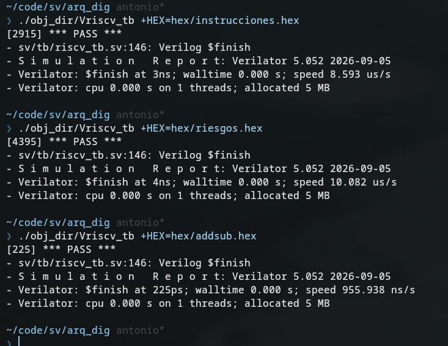

# Procesador RISC-V RV32I en SystemVerilog

Core RV32I completo (ALU, banco de registros, loads/stores, saltos, riesgos de
datos y de control) y programas de prueba autocomprobables (Práctica 4).

## Estructura

```
.
├── s/                  programas en ensamblador
│   ├── check.inc       macros de los tests (INIT / CHECK / END)
│   ├── addsub.s        ejemplo básico: cadena de addi + load
│   ├── instrucciones.s TEST 1: cada instrucción con valores límite
│   └── riesgos.s       TEST 2: saltos, jal/jalr, load->uso, anulación, bucle que acumula
├── elf/                (generado) ejecutables enlazados
├── hex/                (generado) imágenes de memoria que carga el testbench
├── sv/                 RTL: riscv_pkg alu fetch decoder regfile memory core (+ flist.f)
│   └── tb/riscv_tb.sv  testbench del sistema
└── obj_dir/            (generado por Verilator)
```

Todos los comandos se lanzan **desde la raíz del proyecto**.

## Cómo compilar mediante riscv64-elf-gcc

Completamente válido usar riscv32-elf-gcc porque usamos el flag -march=rv32i para utilizar 32b en vez de 64b.

```
s/programa.s --(gcc + objcopy)--> hex/programa.hex --(cargarlo en el tb)--> simulación
                                                           ^
                     sv/*.sv --(verilator, UNA sola vez)--> obj_dir/Vriscv_tb
```

1. **Ensamblar el programa**
2. **Compilar el hardware con Verilator u otra herramienta**
3. **Simular**

```bash
mkdir -p elf hex

# 1) ensamblar y generar el .hex
riscv64-elf-gcc -march=rv32i -mabi=ilp32 -mno-relax -nostdlib -Ttext=0x0 \
    -Wl,--no-relax -Wl,-e,_boot -Wl,-Tdata=0x2000 -Wa,-Is \
    s/riesgos.s -o elf/riesgos.elf
riscv64-elf-objcopy -O verilog --verilog-data-width=4 elf/riesgos.elf hex/riesgos.hex

# 2) compilar el hardware (solo si cambias el RTL)
verilator --binary -Wall --timing -Isv -f sv/flist.f --top riscv_tb

# 3) simular eligiendo el programa
./obj_dir/Vriscv_tb +HEX=hex/riesgos.hex
```

**Qué .hex carga el testbench:** el parámetro `HEX_FILE` de `riscv_tb.sv` es el
valor por defecto. Si **NO** se adjunta nada mediante comandos se utiliza el hex file
adjunto en el tb. Si se adjunta mediante comandos como en el paso 3, se utiliza ese hex.

**Qué hace `check.inc`:** es un fichero de texto con macros. La línea
`.include "check.inc"` hace que el ensamblador lo copie en el sitio.

Opciones del `gcc` (si se omiten, falla en silencio):

| Opción                             | Por qué                                                                                   |
| ---------------------------------- | ----------------------------------------------------------------------------------------- |
| `--verilog-data-width=4` (objcopy) | la memoria es de 32 bits                                                                  |
| `-mno-relax` / `--no-relax`        | sin libc nadie inicializa `gp`; el enlazador convertiría `la` en accesos relativos a `gp` |
| `-Wl,-Tdata=0x2000`                | `.data` en una dirección fija                                                             |
| `-Wa,-Is`                          | dónde buscar `check.inc`                                                                  |

(Prefijo `riscv64-unknown-elf-` en Debian/Ubuntu.)

El programa termina escribiendo en el **mailbox** (`0x10000`): `0x900D` = PASS,
otro valor = nº de la comprobación que falló. Opciones del simulador:
`+HEX=fichero.hex`, `+EXPECT_ILLEGAL=n`, `+MAX_CYCLES=n`, `+TRACE`
(pc y registros por ciclo, para depurar un fallo).

## Atajo: lanzar los tres programas

Con el hardware ya compilado (paso 2):

```bash
for t in addsub instrucciones riesgos; do
  riscv64-elf-gcc -march=rv32i -mabi=ilp32 -mno-relax -nostdlib -Ttext=0x0 \
      -Wl,--no-relax -Wl,-e,_boot -Wl,-Tdata=0x2000 -Wa,-Is s/$t.s -o elf/$t.elf &&
  riscv64-elf-objcopy -O verilog --verilog-data-width=4 elf/$t.elf hex/$t.hex &&
  printf "%-14s" $t && ./obj_dir/Vriscv_tb +HEX=hex/$t.hex | grep "\*\*\*"
done
```

Salida esperada: `*** PASS ***` en los tres.

## Ejecución en otras herramientas gráficas (Questasim / Vivado)

El RTL en SystemVerilog es totalmente estándar. El fichero `.hex` generado utiliza el formato estándar de Verilog, por lo que es compatible directamente mediante `$readmemh`.

Asegúrate de que el testbench (`sv/tb/riscv_tb.sv`) apunte al `.hex` deseado. Por defecto está "program.hex".

## Microarquitectura

- **Fetch** busca la instrucción; **Exec** decodifica, lee registros, ejecuta, accede a memoria y decide el salto en un solo ciclo; los **loads** escriben su dato un ciclo después.
- **Riesgo load->uso:** el dato se reenvía a los operandos. Sin paradas.
- **Riesgo de control:** un salto tomado anula la instrucción siguiente (no escribe, no salta, no cuenta como ilegal). 1 ciclo de penalización.
- **Ilegales:** solo se señalizan (`illegal_instr`) y no tienen efecto. `fence`, `ecall` y `ebreak` son legales y no hacen nada.
- **No soportado:** accesos no alineados, excepciones, CSR.

## Cómo funcionan los tests

`CHECK registro, esperado` compara el resultado y acumula cualquier diferencia
en `a0`; `END` escribe `0x900D` si `a0` quedó a cero. Aunque un `bne` estuviese
roto, el error llegaría al final. Registros reservados: `a0`, `s11`, `t5`, `t6`.

Los saltos condicionales se comprueban con `BTEST` (en `riesgos.s`): tras el
salto hay dos `addi` que deben **anularse** si se toma (`t0 = 4`) y ejecutarse
si no (`t0 = 7`).

## Ejemplo de ejecución


